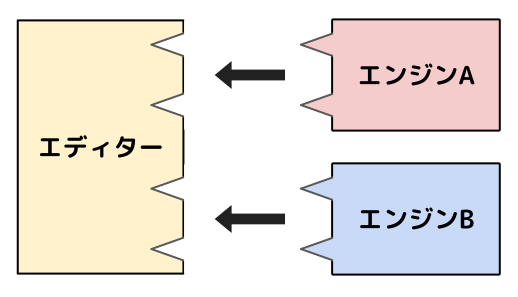

# マルチエンジン機能ガイド

VOICEVOX エディターでは、複数のエンジンを同時に起動することができます。
この機能を利用することで、自作の音声合成エンジンや既存の音声合成エンジンを VOICEVOX エディター上で動かすことが可能です。

## マルチエンジン機能の仕組み

VOICEVOX API に準拠した複数のエンジンの Web API をポートを分けて起動し、統一的に扱うことでマルチエンジン機能を実現しています。
エディターがそれぞれのエンジンを実行バイナリ経由で起動し、EngineID と結びつけて設定や状態を個別管理します。

## マルチエンジン機能への対応方法

VOICEVOX API 準拠エンジンを起動する実行バイナリを作ることで対応が可能です。
VOICEVOX ENGINE リポジトリを fork し、一部の機能を改造するのが簡単です。

改造すべき点はエンジン情報・キャラクター情報・音声合成の３点です。

エンジンの情報はルート直下のマニフェストファイル（`engine_manifest.json`）で管理されています。
この形式のマニフェストファイルは VOICEVOX API 準拠エンジンに必須です。
マニフェストファイル内の情報を見て適宜変更してください。
音声合成手法によっては、例えばモーフィング機能など、VOICEVOX と同じ機能を持つことができない場合があります。
その場合はマニフェストファイル内の`supported_features`内の情報を適宜変更してください。

キャラクター情報は`resources/character_info`ディレクトリ内のファイルで管理されています。
ダミーのアイコンなどが用意されているので適宜変更してください。

音声合成は`voicevox_engine/tts_pipeline/tts_engine.py`で行われています。
VOICEVOX API での音声合成は、エンジン側で音声合成用のクエリ `AudioQuery` の初期値を作成してユーザーに返し、ユーザーが必要に応じてクエリを編集したあと、エンジンがクエリに従って音声合成することで実現しています。
クエリ作成は`/audio_query`エンドポイントで、音声合成は`/synthesis`エンドポイントで行っており、最低この２つに対応すれば VOICEVOX API に準拠したことになります。

## マルチエンジン機能対応エンジンの配布方法

VVPP ファイルとして配布するのがおすすめです。
VVPP は「VOICEVOX プラグインパッケージ」の略で、中身はビルドしたエンジンなどを含んだディレクトリの Zip ファイルです。
拡張子を`.vvpp`にすると、ダブルクリックで VOICEVOX エディターにインストールできます。

エディター側は受け取った VVPP ファイルをローカルディスク上に Zip 展開したあと、ルートの直下にある`engine_manifest.json`に従ってファイルを探査します。
VOICEVOX エディターにうまく読み込ませられないときは、エディターのエラーログを参照してください。

また、`xxx.vvpp`は分割して連番を付けた`xxx.0.vvppp`ファイルとして配布することも可能です。
これはファイル容量が大きくて配布が困難な場合に有用です。
インストールに必要な`vvpp`および`vvppp`ファイルは`vvpp.txt`ファイルにリストアップしています。

開発の詳しい手順は [CONTRIBUTING.md](./CONTRIBUTING.md) を御覧ください。
